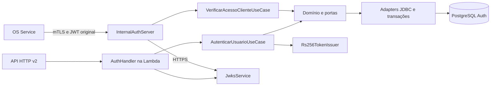

# Tech Challenge Oficina — Auth

[](https://sonarcloud.io/summary/new_code?id=AuroNet0_tech-challenge-oficina-auth)
[](https://sonarcloud.io/summary/new_code?id=AuroNet0_tech-challenge-oficina-auth)

Serviço de identidade em Java 21, com PostgreSQL próprio e autenticação por email e senha.
A Lambda recebe eventos API Gateway HTTP API v2, emite JWT RS256 e publica chaves públicas em JWKS.
O runtime HTTPS `auth-internal` verifica o vínculo atual entre usuário e cliente para o OS Service.
Domínio e casos de uso são compartilhados pelos adapters, sem Spring ou JPA.

## 2. Arquitetura do serviço



Não há RabbitMQ no fluxo implementado. O diagrama reúne componentes do código; a publicação HTTP externa depende da infraestrutura.

Pacotes sob `br.com.fiap.oficina.auth`:

| Pacote | Responsabilidade |
| --- | --- |
| `handler` | Entrada Lambda: login e JWKS |
| `application/usecase` | Autenticação, cadastro, busca, desativação, papéis, vínculos e verificação de acesso |
| `application/port/in`, `application/port/out` | Contratos de entrada, persistência, transação e segurança |
| `domain/model`, `domain/enums`, `domain/exception` | Usuário, vínculo de cliente, papéis e invariantes |
| `infrastructure/persistence/jdbc` | Repositório, transações e limitação de tentativas |
| `infrastructure/security` | Argon2id, RS256, chaves e JWKS |
| `infrastructure/config` | Composição, datasource, migração explícita e gerador local de chaves |
| `infrastructure/internal` | Servidor HTTPS, TLS, inicialização e probe |
| `service`, `model` | Classes remanescentes, incluindo `JwtService` legado, fora da emissão atual |

## 3. API e autenticação

As rotas estão em [AuthHandler](src/main/java/br/com/fiap/oficina/auth/handler/AuthHandler.java) e [InternalAuthServer](src/main/java/br/com/fiap/oficina/auth/infrastructure/internal/InternalAuthServer.java). Não há controllers Spring ou `SecurityConfig`.

| Método | Caminho | Papel (role) exigido |
| --- | --- | --- |
| POST | `/api/v1/auth/login` | Nenhum; exige credenciais `email` e `senha` |
| GET | `/.well-known/jwks.json` | Nenhum; chaves públicas |
| POST | `/internal/v1/identity/client-access/check` | Serviço `os-service` por mTLS e JWT válido; decisão positiva exige usuário ativo, papel `CLIENTE` atual e vínculo persistido |
| GET | `/health/live` | Nenhum; HTTPS interno |
| GET | `/health/ready` | Nenhum; HTTPS interno |

O listener interno não oferece login ou JWKS. Não há rotas HTTP administrativas para cadastro, papéis ou vínculos.

O login aceita exatamente os campos textuais `email` e `senha`, com `Content-Type: application/json`. Normaliza o email, verifica a senha Argon2id e consulta estado e papéis no banco Auth. Credenciais inválidas e usuário inativo recebem `401`; CPF não autentica. O sucesso retorna `accessToken`, `tokenType` (`Bearer`) e `expiresIn`. Detalhes: [autenticação](docs/authentication.md).

O [emissor](src/main/java/br/com/fiap/oficina/auth/infrastructure/security/Rs256TokenIssuer.java) fixa RS256, `typ=JWT` e `kid`. Emite `sub` com UUID do usuário, `iss`, `aud`, `iat`, `nbf`, `exp`, `jti` e `roles` do banco. Os papéis possíveis são `ATENDENTE`, `MECANICO`, `CLIENTE` e `GERENTE`, conforme o enum `Papel`, sem concessão automática. TTL permitido: 60 a 900 segundos, padrão de 900.

`AUTH_JWT_ISSUER` e `AUTH_JWT_AUDIENCE` são obrigatórios. O issuer deve ser HTTPS; o exemplo local usa `https://auth.local.test` e `oficina`. Valores produtivos não identificados. O [verificador interno](src/main/java/br/com/fiap/oficina/auth/infrastructure/security/InternalUserTokenVerifier.java) exige assinatura RS256 com chave pública conhecida, issuer exato, audiência esperada no array `aud`, UUIDs de `sub`/`jti`, nomes conhecidos em `roles` e condições temporais de `iat`/`nbf`/`exp`, incluindo TTL máximo de 900 segundos. A autorização consulta papel e vínculo atuais no banco.

Swagger/OpenAPI não é publicado: não há dependência, documento ou rota correspondente no código/configuração. Uma política explícita de proibição não foi identificada; a ausência não comprova essa política.

### Canal interno Auth–OS

O POST interno exige certificado confiável com EKU `clientAuth` e Subject X.500 exato, por padrão `CN=os-service`. O corpo contém somente `clienteId`, `userAccessToken`, `requestId` e `issuedAt`. O JWT original autentica o usuário, e o certificado autentica o serviço. A resposta é `{"autorizado":true}` ou `{"autorizado":false}`. Falhas de dependências não autorizam acesso.

O runtime obtém chaves públicas da URL HTTPS confiável `AUTH_JWKS_URI`. Contrato, variáveis TLS e limites: [Auth interno](docs/9.2.3.1-auth-interno-kubernetes.md).

### Coleção Postman

Arquivos disponíveis: a coleção [docs/postman/auth-collection.json](docs/postman/auth-collection.json), com login por perfil, JWKS e casos negativos, e o ambiente [docs/postman/enviroment.json](docs/postman/enviroment.json), com variáveis compartilhadas por todas as coleções do projeto.

1. Importe os dois arquivos no Postman.
2. Selecione o ambiente **Oficina - AWS**.
3. Preencha `baseUrl` com a URL do API Gateway do ambiente e os campos de e-mail/senha dos perfis Atendente, Mecânico, Cliente e Gerente; o ambiente é entregue sem credenciais.
4. Execute a pasta **Login**, que salva os tokens em `tokenAtendente`, `tokenMecanico`, `tokenCliente` e `tokenGerente`.

O mesmo ambiente é usado pelas coleções dos demais serviços e do fluxo completo; não há credenciais nem tokens versionados nesses arquivos.

## 4. Dados

PostgreSQL (SQL), com banco próprio de identidade. `oficina_auth` é o nome configurado em [.env.example](.env.example). O [Compose](compose.yaml) cria uma instância local dedicada; o nome efetivo vem de `AUTH_DB_NAME`. O código exige `AUTH_DB_*`, sem fallback para o banco dos serviços de negócio. O nome do banco efetivamente implantado não é verificável aqui.

As migrações Flyway [V1](src/main/resources/db/migration/V1__create_identity_schema.sql) e [V2](src/main/resources/db/migration/V2__create_login_rate_limits.sql) criam `usuarios`, `usuario_papeis`, `usuario_clientes` e `login_tentativas`. `cliente_id` é um vínculo lógico, sem FK para banco externo. A migração ocorre separadamente por `MigrateIdentity`, sem execução automática na inicialização dos runtimes.

## 5. Mensageria

Não há mensageria implementada no Auth. Código, dependências e Compose não apresentam cliente RabbitMQ, configuração de broker, exchanges, filas, DLQ, retry de mensagens, consumidores, publicadores, Inbox ou Outbox. Não há documento dedicado de mensageria deste serviço. As referências a mensagens no [levantamento de autorização](docs/security/authorization-8.3.1.md) tratam de outros serviços.

## 6. Papel na Saga e compensação

O Auth **não participa da Saga** e não executa compensações. Fornece JWT e JWKS para autenticação e validação de identidade pelos serviços, além da verificação síncrona de vínculo no canal Auth–OS. Não há orquestrador, estados de Saga ou comandos de compensação neste repositório.

## 7. Execução local e testes

Pré-requisitos: JDK 21, Maven e Docker ativo com containers Linux. Não há Maven Wrapper; use `mvn`. O Compose inicia somente o PostgreSQL.

1. Copie `.env.example` para `.env` e preencha os placeholders localmente, sem versionar credenciais.
2. Exporte `AUTH_*` no processo Java. O Compose lê `.env`; o Java não o carrega automaticamente.
3. Inicie o banco e execute a suíte:

```bash
docker compose --env-file .env up -d --wait
mvn clean verify
```

4. Migre o banco local explicitamente:

```bash
java -cp target/tech-challenge-oficina-auth.jar br.com.fiap.oficina.auth.infrastructure.config.MigrateIdentity
```

O exemplo configura `AUTH_ENVIRONMENT`, `AUTH_DB_HOST`, `AUTH_DB_PORT`, `AUTH_DB_NAME`, `AUTH_DB_USER`, `AUTH_DB_PASSWORD` e `AUTH_DB_SSLMODE`. Para login/JWKS, configure também `AUTH_KEY_PROVIDER`, `AUTH_LOCAL_KEY_FILE`, `AUTH_JWT_ISSUER`, `AUTH_JWT_AUDIENCE` e `AUTH_JWT_TTL_SECONDS`, conforme [autenticação](docs/authentication.md). O provedor de arquivo e `sslmode=disable` são restritos ao modo local; o banco sem TLS exige host literal `127.0.0.1`.

Com `AUTH_KEY_PROVIDER=local-file`, `AUTH_ENVIRONMENT=local` e caminho absoluto privado em `AUTH_LOCAL_KEY_FILE`, gere as chaves explicitamente:

```bash
java -cp target/tech-challenge-oficina-auth.jar br.com.fiap.oficina.auth.infrastructure.config.GenerateLocalKeys
```

O arquivo não é sobrescrito; a chave começa a assinar após a janela inicial de publicação de 90 segundos. Não há usuário/senha padrão; o provisionamento ocorre por casos de uso internos com autorização.

`mvn test` executa unitários. `mvn clean verify` inclui integrações PostgreSQL com Testcontainers, pacote e gate JaCoCo. Os bancos de teste são descartáveis e independem do Compose. Docker é obrigatório para essas integrações. Para incluir o teste da imagem produtiva, que sem a propriedade fica ignorado:

```bash
docker build -t oficina-auth:ci .
mvn clean verify -Dauth.internal.image=oficina-auth:ci
```

O runtime interno exige banco, `AUTH_JWKS_URI`, issuer/audience e stores PKCS12 com suas senhas e certificados confiáveis. Sua entrada é `InternalAuthMain`; configuração completa em [Auth interno](docs/9.2.3.1-auth-interno-kubernetes.md). O harness `integration/8.3.5/AuthLocalRuntime.java` é separado da imagem produtiva.

Encerre o banco preservando o volume com `docker compose down`.

## 8. Qualidade e cobertura

O [pom.xml](pom.xml) aplica JaCoCo na fase `verify`: regra `BUNDLE`, contador `LINE`, razão `COVEREDRATIO` mínima de `0.80` (80%). Relatórios locais são gerados em `target/site/jacoco/index.html` e `jacoco.xml`.

Cobertura SonarCloud informada para a análise de **13/11/2026: 87,7%**, fornecida para esta atualização, sem nova medição local. Projeto: [SonarCloud](https://sonarcloud.io/summary/new_code?id=AuroNet0_tech-challenge-oficina-auth).

A imagem solicitada `docs/img/sonarcloud.png` não existe no repositório. A marcação `` fica registrada como código, sem criar um link relativo quebrado; sua publicação depende da inclusão futura do arquivo.

## 9. CI/CD

O workflow é [.github/workflows/ci.yml](.github/workflows/ci.yml): `pull_request` e `push` para `main` e `homolog`, além de `workflow_dispatch`.

O job `verify` configura Java 21 e Python 3.13, testa o verificador de build, constrói a imagem Linux/amd64 e executa `mvn -B -ntp clean verify -Dauth.internal.image="$IMAGE"`, incluindo testes, gate JaCoCo e verificação do runtime da imagem. Depois executa análise SonarCloud. A espera bloqueante pelo Quality Gate (`sonar.qualitygate.wait=true`) ocorre somente em **push na main**; falhas da própria análise continuam falhando a etapa nos demais eventos. `SONAR_TOKEN` é exigido em toda execução dessa etapa.

Depois da análise, `scripts/verify_build.py --image` confere relatórios, pacote, imagem e proveniência local. A varredura implementada procura padrões de chaves privadas, access keys AWS, JWTs completos e nomes de arquivos sensíveis no JAR, no JAR da imagem e em `src/main`; não cobre integralmente o histórico Git. A verificação completa também rejeita testes ignorados. Resumos sanitizados são gerados/publicados com `always()`.

O job `deploy` depende de `verify` e roda **somente em push na main**. Assume role AWS via OIDC e consulta EKS/ECR no preflight. Se cluster ou repositório não existir, registra skip; outros erros falham. Quando existem, usa o SHA completo como tag: reutiliza a imagem existente ou constrói e publica a tag. Atualiza o Deployment por digest `sha256`, usando `kubectl set image` e `kubectl rollout status --timeout=300s`. O workflow não atualiza a Lambda.

| Nome | Origem | Uso |
| --- | --- | --- |
| `SONAR_TOKEN` | Secret do GitHub Actions | Análise SonarCloud |
| `AWS_ROLE_ARN` | Variável do GitHub Actions (`vars`) | Role assumida via OIDC no deploy |
| `GITHUB_TOKEN` | Token disponibilizado pelo GitHub Actions | Ambiente da etapa SonarCloud |

## 10. Implantação

A Lambda de login é provisionada pelo stack `edge`, e o pod `auth-internal` pelo stack `platform` do repositório [tech-challenge-oficina-k8s-infra](https://github.com/AuroNet0/tech-challenge-oficina-k8s-infra), conforme a organização de infraestrutura indicada para o projeto. O serviço interno roda no EKS por meio dos manifestos gerados pelo stack `platform`; o `ci.yml` deste repositório faz o deploy de sua imagem. A geração e o estado efetivo desses recursos externos não são verificáveis neste checkout.

| Configuração | Valor no workflow/runtime |
| --- | --- |
| Região AWS | `us-east-1` |
| Cluster EKS e namespace | `tc-oficina-p4-demo-a` |
| Deployment e container | `auth-internal` |
| Repositório ECR | `tc-oficina-p4-demo-a-auth` |
| Referência implantada | Registry obtido da conta AWS em execução, repositório e digest |
| Porta | HTTPS `8443`, exposta no Dockerfile e padrão de `AUTH_INTERNAL_PORT` |
| Liveness | `GET /health/live` |
| Readiness | `GET /health/ready` |

A pasta `k8s/` contém [k8s/auth-internal.yaml](k8s/auth-internal.yaml), com manifestos de referência de ServiceAccount, ConfigMap, Service e Deployment do pod `auth-internal` (canal interno Auth–OS), que espelham o que o stack `platform` do repositório `tech-challenge-oficina-k8s-infra` aplica no EKS. Os valores entre `<...>` (endpoint do RDS, issuer/audience/JWKS, conta AWS e tag ou digest da imagem) são fornecidos pela infraestrutura em cada ambiente; segredos de TLS e banco são referenciados por nome e não ficam no repositório. O Job de migração do banco Auth é criado pela infraestrutura a cada deploy, e o login público (Lambda) é provisionado pelo stack `edge`; nenhum dos dois está replicado em `k8s/`. O arquivo não é aplicado diretamente por este repositório: o deploy da infraestrutura provisiona e aplica os recursos no cluster, enquanto o job `deploy` do `ci.yml` apenas atualiza a imagem do Deployment com `kubectl set image`.

Readiness verifica validade do certificado, chaves JWKS e consultas às tabelas de identidade. Liveness responde sem consultar essas dependências enquanto o servidor não está encerrando. O `HEALTHCHECK` do [Dockerfile](Dockerfile) executa `InternalHealthProbe`. Não há fontes Terraform de provisionamento versionadas neste serviço.

## 11. Estrutura do repositório

| Pasta | Conteúdo |
| --- | --- |
| `src/main/java` | Domínio, casos de uso, Lambda e runtime interno |
| `src/main/resources/db/migration` | Migrações Flyway V1/V2 |
| `src/test` | Unitários, integrações PostgreSQL e teste da imagem |
| `docs` | Contratos e registros das etapas de segurança |
| `docs/postman` | Coleção Postman do serviço e ambiente compartilhado |
| `k8s` | Manifestos Kubernetes de referência do pod auth-internal |
| `integration/8.3.5` | Fixtures e runtime local; mantidos porque o ambiente BDD do billing-service monta essa pasta, conforme o registro de integração no documento de Auth interno |
| `scripts` | Contrato e verificador de build, com testes Python |
| `.github/workflows` | CI e deploy da imagem interna |
