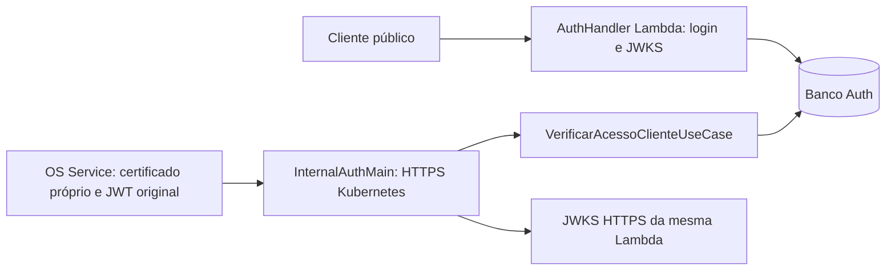

# 9.2.3.1 — Auth interno para Kubernetes

> Atualização documental em 13/11/2026: este documento preserva o registro e as
> evidências locais de 31/10–01/11. O CI/CD atual está no [README](../README.md).
> A Lambda de login e o pod `auth-internal` são provisionados pelos stacks `edge`
> e `platform`, respectivamente, do repositório
> [tech-challenge-oficina-k8s-infra](https://github.com/AuroNet0/tech-challenge-oficina-k8s-infra),
> conforme a organização indicada para o projeto. O `ci.yml` deste serviço implanta
> a imagem do pod `auth-internal` no EKS somente em push na `main`; não atualiza a Lambda.
> Propostas e pendências operacionais abaixo são históricas, sem comprovar o estado externo atual.

Implementação: 31/10/2026; validação: 01/11/2026. Execução local; nenhum deploy,
commit ou push.

## 1. Base e inspeção

O checkout inicial estava limpo em `homolog`, HEAD
`34f5c229e73ddc6d1950be977a5e2775a93bab74`. Era uma versão antiga, com login
por CPF e HS256, incompatível com as premissas da etapa. Após consultar o remoto,
foi feito exclusivamente fast-forward para `origin/homolog`,
`88fe949df9216fd861a2ad3844f2b0e5867883f6`. Não foi criado commit. As diferenças
trazidas por esse fast-forward são histórico existente, não alterações desta entrega.

Inspecionados antes da implementação: AuthHandler, AuthBootstrap/AuthServices,
AuthDatabase, JdbcIdentityTransaction/JdbcUsuarioRepository, domínio Usuario,
VerificarAcessoClienteUseCase, InternalClientAccessRequest/InternalUserTokenVerifier,
emissor RS256, JwksService, SigningKey, RotatingKeyProvider, fontes locais/Secrets
Manager, MigrateIdentity e migrações V1/V2, testes e documentos de identidade.

O harness `integration/8.3.5/AuthLocalRuntime.java` exige ambiente local, adapta
login/JWKS à Lambda, usa chaves de assinatura e executor sem encerramento explícito.
Seu ciclo de vida e superfície HTTP não foram levados à imagem produtiva.
Foram examinados também os Compose e README de 8.3.5 e 9.1.4 no Billing,
snapshot `c87c72f69c44978ff1211e19c582dd0c6ec2a6ad`. A 9.1.4 reutiliza esse
mesmo harness Auth, certificados efêmeros, TLS `want` e Subject `CN=os-service`.
Os resultados históricos 641/206 não são resultados de uma nova execução aqui.

O consumidor atual foi conferido diretamente em
`src/main/java/com/oficina/os/infrastructure/identity/MtlsClientAccessAdapter.java`
da branch homolog do OS: HTTPS obrigatório, timeout de conexão 2 s, chamada 3 s,
JWT original do JwtAuthenticationToken, envelope com quatro campos e retorno
booleano estrito com `Cache-Control: no-store`. Não houve alteração no OS.

Platform local conferida em `be61cb97951e5c184c5d7c7c848347f82f19060d`,
incluindo applications, outputs, variables, kubernetes, network-policies e
documento 9.2.3. Nenhum arquivo de infraestrutura foi alterado.

## 2. Dois runtimes, uma identidade



O handler público permanece intacto, com contrato HTTP API v2, Argon2id,
limitação de tentativas, RS256/JWKS e Secrets Manager. Não existe bind entre
o handler e o servidor interno. Não há login, cadastro, consulta pública de
usuário ou emissão de JWT no listener Kubernetes.

Reutilização: InternalClientAccessRequest valida envelope e frescor;
InternalUserTokenVerifier autentica o token; IdentidadeAcessoCliente e
VerificarAcessoClienteUseCase aplicam autorização técnica/temporal e consultam
o estado atual; JdbcIdentityTransaction/JdbcUsuarioRepository preservam
transação, bloqueio, commit/rollback e modelo N:N. Usuario.podeAcessarCliente
continua exigindo usuário ativo, papel CLIENTE atual e vínculo persistido.
Nenhuma regra de identidade foi duplicada.

Novos componentes produtivos:

- `InternalAuthMain`: composição independente e shutdown hook.
- `InternalAuthServer`: HTTP HTTPS com limites, probes e tradução de erros.
- `InternalTls`: stores explícitos, validação temporal e identidade técnica.
- `TrustedJwksProvider`: somente chaves públicas, cache limitado e refresh HTTPS.
- `InternalHealthProbe`: healthcheck Docker HTTPS com validação de certificado.

## 3. Contrato HTTPS preservado

O caminho produtivo é **POST `/internal/v1/identity/client-access/check`**.
O nome `/internal/client-access` do enunciado não substitui o contrato aprovado;
esse caminho abreviado recebe 404. Porta padrão 8443; Content-Type exato
`application/json`, sem query string.

```json
{
  "clienteId": "00000000-0000-0000-0000-000000000001",
  "userAccessToken": "<JWT RS256 original do usuário>",
  "requestId": "00000000-0000-0000-0000-000000000002",
  "issuedAt": "2026-10-31T12:00:00Z"
}
```

Exatamente quatro campos textuais; UUIDs canônicos minúsculos; JSON sem
duplicatas/trailing content; UTF-8 estrito; corpo até 12.288 bytes, token até
8.192 caracteres. issuedAt aceita até 5 s no futuro e menos de 60 s de idade.
Não aceita usuarioId/roles/ativo fornecidos no JSON. O usuário deriva somente
do `sub` verificado. Um quinto campo tentando substituir o usuário gera 400.

requestId é a correlação já transportada pelo OS no corpo. Após validação
temporal, ele é devolvido também em `X-Correlation-ID`, sem alterar o JSON.
Headers declarativos de usuário/serviço não são utilizados para autenticar.

| Situação | HTTP | Corpo |
| --- | --- | --- |
| Vínculo atual autorizado | 200 | `{"autorizado":true}` |
| Usuário inexistente/inativo/sem CLIENTE ou vínculo | 200 | `{"autorizado":false}` |
| Sem certificado, JWT inválido/expirado ou envelope antigo | 401 ou rejeição TLS para certificado inválido | `{}` se houver HTTP |
| Certificado confiável de outro serviço | 403 | `{}` |
| Envelope, método ou Content-Type inválido | 400 | `{}` |
| Rota desconhecida | 404 | `{}` |
| Persistência, JWKS ou outra dependência indisponível | 503 | `{}` |

Todas as respostas HTTP usam application/json, `Cache-Control: no-store` e
nosniff. Nenhuma retorna nome, e-mail, CPF, papéis ou lista de clientes.
Não há cache de decisão positiva nem fallback que autorize em falha.

## 4. mTLS

SSLContext próprio, PKCS12 explícitos e TrustManager JSSE padrão validam a
cadeia e uso TLS. TLS 1.2/1.3 apenas. O certificado do servidor e sua cadeia
são verificados temporalmente no bootstrap e novamente antes das operações.
A emissão por ambiente deve incluir SAN `auth-internal` e o FQDN do Service,
mais `localhost` se for utilizado o healthcheck Docker padrão.

O socket pede certificado opcional (`want`) para permitir probes sem identidade
OS. **A rota protegida exige o certificado real da SSLSession**; ausência gera
401 antes do parser/banco. Não há autenticação por proxy/header. Cadeia não
confiável ou certificado TLS inválido é rejeitado no handshake; adicionalmente
cada certificado da sessão é verificado temporalmente em toda autorização,
inclusive sessões reutilizadas. O leaf deve ser não-CA, ter EKU clientAuth e
Subject X.500 exatamente igual ao configurado, por padrão `CN=os-service`.
A configuração recusa Subject de outro serviço. Não há comparação por substring.

Truststore de entrada: somente a CA privada do ambiente e intermediárias
necessárias, controladas pela PKI. A CA não deve emitir identidade OS para outro
workload. Chaves de servidor/OS são distintas e montadas por Secret. Nenhuma
chave/certificado privado é copiado pelo Docker build.

Certificados e stores são carregados no startup; rotação exige rollout, antes
do vencimento. Não há revogação online OCSP/CRL implementada; usar validade
curta, PKI controlada e rollout em revogação. NetworkPolicy é defesa adicional.

## 5. JWT, JWKS e rotação

InternalUserTokenVerifier existente restringe RS256, typ JWT e kid conhecido;
exige assinatura válida, issuer exato, audience esperada em array, sub/jti UUID,
roles array com nomes conhecidos, iat/nbf/exp inteiros, nbf=iat, iat não futuro,
exp posterior a agora e TTL máximo 900 s. Não segue jku/x5u do token. Relógios
devem estar sincronizados; não foi adicionado skew permissivo.

TrustedJwksProvider consulta somente AUTH_JWKS_URI confiável via HTTPS com
validação normal de hostname/CA, sem redirects. Connect timeout 1 s, deadline
total 2 s, resposta limitada em streaming a 64 KiB, JSON estrito e até oito
chaves RSA RS256 de assinatura com kid único. Módulo/expoente passam pelas
mesmas restrições de SigningKey, com chave privada null. ativa() sempre falha.
As janelas artificiais de SigningKey apenas representam material público:
a publicação/retirada efetiva é governada pelo JWKS autenticado, não por uma
segunda política de emissão. Nenhuma privateKey/Secret de assinatura é exigido.

Cache de chaves por até 30 s, sem stale-on-error. Depois de expirar, falha de
refresh torna o runtime não pronto e a autorização retorna 503. kid desconhecido
retorna 401, sem fetch escolhido pelo usuário ou refresh ilimitado por token.
Preservar as regras do emissor: publicar nova chave pelo menos 90 s antes de
assinar; manter antiga por pelo menos 1.050 s após signUntil. A sobreposição
absorve cache interno de 30 s e Cache-Control público de 60 s. O endpoint deve
fornecer somente o mesmo conjunto da Lambda. Não há segundo issuer.

O cliente JWKS usa roots públicas da JRE por padrão; não usa o truststore mTLS
privado de entrada. Para uma CA HTTPS privada adicional, montar um truststore
de saída com roots JRE + CA necessária e configurar propriedades JSSE no comando
Java, sem imprimir senha em JAVA_TOOL_OPTIONS. Não usar trust-all.

## 6. Persistência e migrações

AuthDatabase é reutilizado com overload interno; a chamada original da Lambda
mantém seus valores. Somente AUTH_DB_* e banco lógico Auth são utilizados.
Hikari interno: máximo 2 conexões (configurável 1–4), mínimo 0, aquisição 500 ms,
validação 250 ms, connect/socket PostgreSQL 1 s, statement_timeout 500 ms,
lock_timeout 250 ms, idle_in_transaction 2 s. Esses limites deixam margem para
o timeout de 3 s do OS; saturação gera erro fechado. Pool e latência devem ser
medidos no RDS antes de aumentar réplicas. Consultas, transação e locks existentes
não foram removidos. AUTH_DB_SSLROOTCERT permite o bundle RDS montado.

Produção exige verify-full; disable continua restrito ao ambiente local com
host literal 127.0.0.1, usado exclusivamente nos testes efêmeros.
O role Auth precisa de permissões compatíveis com SELECT FOR UPDATE nas tabelas
de identidade; nunca conceder acesso a OS/Billing. O bootstrap de banco da
Platform cria banco/role, não as tabelas de identidade.

V1/V2 originais permanecem intactas. A estratégia é **um único Job de migração**
por release, antes de liberar Lambda e Deployment. Executar a classe existente
MigrateIdentity com o mesmo JAR e credencial Auth de migração, Flyway cleanDisabled,
then validate. Nem o bootstrap Lambda nem o bootstrap interno executam migrate.
Serializar pipelines/jobs e não usar initContainer migrador por réplica. Flyway
mantém histórico/lock como proteção adicional, não como plano de concorrência.
MigrateIdentity continua usando o bootstrap público original: o novo
AUTH_DB_SSLROOTCERT é consumido somente pelo overload interno. Para o Job com
a imagem non-root desta entrega, montar o bundle RDS como
`/home/auth/.postgresql/root.crt` (localização padrão do driver para user.home),
ou fornecer uma configuração de CA equivalente já validada para esse comando.
Não supor que apenas a variável nova configure o Job ou a Lambda.

## 7. Container e ciclo de vida

Dockerfile multi-stage Maven/Java 21 com bases fixadas por digest, dependências e
plugins versionados e outputTimestamp fixo. A imagem copia somente src/main e
pom; .dockerignore impede inclusão de .env, .git, certificados e harnesses.
O JAR Shade mantém o artefato Lambda. Não há dependência produtiva de src/test
ou integration/8.3.5. O entrypoint usa classe principal explícita, independente
de um Manifest Main-Class que pudesse afetar a Lambda.

UID/GID 10001, processo Java PID 1, logs de startup/shutdown em stdout,
heap por MaxRAMPercentage=60 e ActiveProcessorCount=2. Compatível com requests
250m/512Mi e limits 1000m/768Mi da Platform; dimensionamento final requer carga.
Executor com oito workers e fila de 32, backlog 32, conexões máximas 64 e idle
limitado. Limites HTTP de recepção/resposta são 3 s, verificados pelo timer do
servidor a cada segundo. Não interpretar esse timer como SLA estrito de latência.
Cliente OS tem seu deadline próprio. O hook drena servidor por até 5 s, interrompe
workers, fecha pool e cliente JWKS; usar terminationGracePeriodSeconds=45.

HEALTHCHECK chama InternalHealthProbe via HTTPS, validando CA e hostname sem
certificado cliente. AUTH_INTERNAL_PROBE_HOST permite usar o DNS presente no SAN
em vez de localhost. Senhas ficam em env Secret, nunca em camadas da imagem.
O probe tem connect timeout 3 s, request timeout 5 s e limite Docker 8 s, com
start-period 30 s e três tentativas a cada 30 s. Isso acomoda o handshake de uma
JVM recém-iniciada sob limite de CPU, sem ampliar o timeout de negócio do OS.
Falhas registram somente status ou classe da exceção, sem causas/credenciais.
Build local: `docker build -t oficina-auth-internal:9.2.3.1 .`.
Publicação ECR por digest é uma próxima etapa; não foi realizada.

## 8. Probes

| Finalidade | Endpoint HTTPS | Sem certificado OS | Dependências |
| --- | --- | --- | --- |
| startup/liveness | GET /health/live | Sim | Processo/listener |
| readiness | GET /health/ready | Sim | Validade TLS, JWKS atual e tabelas Auth acessíveis |

Retorno mínimo `{"status":"UP"}` em 200; readiness falha com 503 e `{}`.
Não revela host/credenciais/exceções. HTTPGet nativo HTTPS do kubelet não exige
certificado cliente, mas não valida o certificado servidor: não conta como prova
mTLS. Testes com clientes HTTPS normais validam cadeia/hostname separadamente.
As probes devem ser permitidas somente na rede operacional/nós. Readiness pode
ultrapassar 3 s numa combinação de falhas; timeout do kubelet continua retirando
o pod. Não vincular liveness ao banco, evitando restart em cascata.

## 9. Matriz de configuração Kubernetes

| Input runtime | Valor/origem Platform | Ajuste necessário |
| --- | --- | --- |
| AUTH_INTERNAL_PORT | 8443, Service auth-internal já existente | containerPort https:8443 |
| AUTH_INTERNAL_KEYSTORE | /tls/identity.p12 | Montar auth-internal-tls identity.p12 |
| AUTH_INTERNAL_TRUSTSTORE | /tls/truststore.p12 | CA privada do ambiente para entrada |
| AUTH_INTERNAL_KEYSTORE_PASSWORD | Secret auth-internal-tls/password | secretKeyRef |
| AUTH_INTERNAL_TRUSTSTORE_PASSWORD | Secret auth-internal-tls/password | secretKeyRef |
| AUTH_INTERNAL_OS_SUBJECT | CN=os-service, auth_internal_contract | ConfigMap, match exato |
| AUTH_INTERNAL_PROBE_HOST | localhost ou FQDN SAN do Service | ConfigMap para HEALTHCHECK Docker |
| AUTH_DB_HOST | infra_contract.rds.address | ConfigMap |
| AUTH_DB_PORT | 5432 | ConfigMap |
| AUTH_DB_NAME | application_databases.auth.database | ConfigMap |
| AUTH_DB_USER | Secret auth-postgres/username | secretKeyRef, mesmo role Auth |
| AUTH_DB_PASSWORD | Secret auth-postgres/password | secretKeyRef |
| AUTH_DB_SSLMODE | verify-full | ConfigMap |
| AUTH_DB_SSLROOTCERT | /rds-ca/ca.pem | Montar ConfigMap rds-ca |
| AUTH_INTERNAL_DB_POOL_SIZE | 2, permitido 1–4 | ConfigMap; demais timeouts fixos acima |
| AUTH_JWT_ISSUER | var.jwt.issuer da Lambda | ConfigMap, igualdade exata |
| AUTH_JWT_AUDIENCE | var.jwt.audience | ConfigMap |
| AUTH_JWKS_URI | var.jwt.jwks_uri HTTPS público | ConfigMap; egress HTTPS necessário |
| JAVA_TOOL_OPTIONS | Somente flags não secretas de heap/CPU | Default da imagem ou -Xmx384m |

AUTH_KEY_PROVIDER, AUTH_LOCAL_KEY_FILE, AUTH_KEY_SECRET_ID e chave privada RS256
não são inputs do runtime interno. Não expor certificado/role técnico do OS ao
kubelet. Não expor porta HTTP clara alternativa.

## 10. Ajustes precisos na próxima etapa Platform

1. Acrescentar `images.auth` com digest do ECR já previsto no infra_contract;
   validar seu prefixo como os demais serviços. Preservar application_replicas=0
   até revisão e preflight; atualizar auth_internal_contract somente após aprovação.
2. Declarar Deployment auth-internal usando Service e ServiceAccount já presentes;
   label `app.kubernetes.io/name=auth-internal`, sem exposição por Ingress/ALB.
   Usar entrypoint da imagem, sem substituir por `java -jar /app/app.jar`.
3. ConfigMap/Secrets/volumes conforme matriz. Usar UID/GID 10001, fsGroup que
   permita leitura do Secret 0440, readOnlyRootFilesystem, drop ALL,
   allowPrivilegeEscalation=false, seccomp RuntimeDefault e /tmp em emptyDir.
4. startup/liveness HTTPS `/health/live`, readiness HTTPS `/health/ready`, porta
   nomeada https. Preservar requests/limits e terminationGracePeriodSeconds=45.
5. Emitir certificado auth-internal com SANs internos, serverAuth e prazo do
   ambiente. Truststore de entrada deve confiar somente na PKI técnica local;
   se o bundle atual mistura roots públicas, separar a confiança de entrada da
   confiança HTTPS de saída. OS continua usando sua identidade própria.
6. NetworkPolicies OS→Auth:8443 e Auth→RDS:5432 já previstas; acrescentar egress
   Auth→JWKS:443 e DNS compatível com a política existente. Confirmar regras de
   nós/kubelet para probes, sem abrir rota de negócio publicamente.
7. Job MigrateIdentity único antes dos runtimes, credencial e schema Auth,
   PostgreSQL 17 e bundle RDS. Não executar migrate em cada pod/Lambda.
8. Validar OS real contra imagem Auth, PKI/Secrets do ambiente, rotação JWKS e
   certificados, requests/limits e latências no ambiente homolog antes de liberar.

## 11. Testes e evidências

Os testes novos usam keytool/JDK e CA efêmera, certificados assinados e conexões
HTTPS reais; não substituem TrustManager por trust-all. O cliente de teste força
o envio do certificado desconhecido/expirado para evitar que o caso seja apenas
ausência de certificado por seleção automática do JSSE. Outro serviço com CA
válida recebe 403; certificado OS válido permite decisão mínima. A suíte testa
também vínculo atual, inatividade, papel ausente, identidade JSON extra, falha
transacional, probes e ausência de login/JWKS no runtime interno.

InternalIdentityComponentsTest e regressões existentes cobrem assinatura,
issuer/audience, exp/iat/nbf/sub/jti/roles/kid obrigatórios, algoritmo errado,
payload adulterado e rota interna ausente na Lambda. TrustedJwksProviderTest usa
servidor HTTPS com CA própria para verificar chave pública, cache/rotação,
indisponibilidade sem stale, redirects, JSON inválido e limite de resposta.

InternalContainerIT é opt-in pela propriedade `auth.internal.image` e executa
a imagem previamente construída com PostgreSQL 17 real, fixture JWKS separada,
mTLS, JWT assinado, autorização positiva/negativa, root filesystem readonly e
limites de recursos. Pausa o container do banco para provocar indisponibilidade
real, testa readiness/liveness e resposta 503, SIGTERM e reinício. O fixture
JWKS reside somente em src/test; nenhum harness é adicionado à imagem produtiva.
Fora desse teste efêmero, não configurar disable nem truststore CA de teste.

Comandos reproduzíveis, com Java 21/Maven/Docker no PATH:

```text
docker build -t oficina-auth-internal:9.2.3.1 .
mvn -B clean verify -Dauth.internal.image=oficina-auth-internal:9.2.3.1
git diff --check
```

Sem a propriedade, o teste da imagem é explicitamente skipped; não apresentar
essa execução como validação de container. O gate JaCoCo de 80% permanece ativo,
sem excluir classes novas. Relatórios Maven/JaCoCo ficam em target.

### Resultado final medido

Execução final de 01/11/2026 às 13:39:27, JDK Microsoft 21.0.12.1, Maven 3.9.9,
Docker Desktop Linux. Comando `mvn -B -ntp clean verify
-Dauth.internal.image=oficina-auth-internal:9.2.3.1`: **BUILD SUCCESS**, 3 min 19 s.

| Evidência | Resultado |
| --- | --- |
| Surefire | 83 testes, 0 falhas, 0 erros, 0 skips |
| Failsafe | 17 testes, 0 falhas, 0 erros, 0 skips |
| Total Auth | **100 testes, 0/0/0** |
| JaCoCo linhas | **965/1.069 = 90,27%**, 104 não cobertas |
| Gate | 80% mantido, aprovado sem exclusões novas |
| Empacotamento Shade | target/tech-challenge-oficina-auth.jar, 24.976.163 bytes |
| Imagem | oficina-auth-internal:9.2.3.1, build multi-stage aprovado |
| Runtime | Temurin 21.0.13+9; UID/GID 10001; raiz readonly; limite 768 MiB/1 CPU |
| PostgreSQL 17.6 | V1/V2 migradas/validadas, autorização positiva e negativa reais |
| Falha real de banco | Container PostgreSQL pausado: operação 503, readiness 503, liveness 200 |
| Healthcheck dentro da imagem | InternalHealthProbe executado via docker exec, exit 0 |
| SIGTERM | AUTH_INTERNAL_STOPPED, exit 143; reinício com readiness e nova autorização positiva |
| Limpeza | Containers efêmeros removidos automaticamente; nenhum container remanescente |
| Git whitespace | git diff --check aprovado |

ID local da imagem (não é evidência de publicação ECR):
`sha256:d98813ade5481cf6a7bb72890401f72afbee5d89aeaebb69b26f9c5530b0349c`.
Evidências locais: `target/auth-internal-verify.log`,
`target/auth-internal-docker-build.log`, `target/surefire-reports/`,
`target/failsafe-reports/` e `target/site/jacoco/index.html`/`jacoco.xml`.
Os testes PostgreSQL anteriores, inclusive o probe do JAR público com login,
JWKS e Argon2, também passaram. Os 100 testes pertencem somente ao Auth;
não substituem uma nova execução dos 641 testes/206 E2E dos quatro serviços.

Durante a validação, a preparação do teste foi corrigida para montar os
certificados em volume readonly, pois Docker não permite copyArchive numa raiz
readonly. O teste passou a aguardar readiness real em vez de confundir listener
iniciado com dependências prontas. O healthcheck em JVM nova detectou que o
connect timeout inicial de 1 s era insuficiente sob CPU limitada; foi ajustado
somente no probe operacional e o teste completo do container passou. Tentativas
anteriores permanecem nos logs locais ignorados em .local-secrets.

## 12. Riscos e limites

- Testes locais não equivalem à implantação EKS/RDS nem ao E2E completo dos
  quatro serviços. Os resultados 641/206 anteriores não foram reclassificados.
- requestId correlaciona; não é nonce distribuído de uso único. Repetição dentro
  da janela consulta novamente o vínculo atual. Não há cache positivo.
- Não existe atomicidade distribuída entre decisão Auth e efeito de negócio OS.
- Certificados devem ser renovados com rollout; expiração torna readiness/rota
  indisponíveis. Não há hot reload nem OCSP/CRL online.
- Dependência HTTPS JWKS requer saída controlada; indisponibilidade além do
  cache de 30 s retira prontidão e nega autorização, deliberadamente.
- Validar carga, limites do servidor HTTP JDK, orçamento de timeout e custo das
  probes antes de aumentar concorrência/réplicas. Não há benchmark de produção.
- Dockerfile fixa bases por digest; atualizações de segurança exigem revisão
  periódica desses digests e novo build. Não houve publicação ou scan ECR.

## 13. Arquivos e Git final

Modificados nesta entrega: pom.xml (timestamp reproduzível), AuthDatabase.java
(overload interno com defaults públicos preservados), AuthDatabaseTest.java
(pool/TLS/timeouts internos) e README.md (referência).
Criados: Dockerfile, .dockerignore, quatro classes internal, TrustedJwksProvider,
TestTls, InternalAuthServerTest, TrustedJwksProviderTest, ContainerJwksMain,
InternalContainerIT e este documento. Migrações, handler público, workflows e
Terraform não foram editados.

Estado final: branch `homolog`, HEAD
`88fe949df9216fd861a2ad3844f2b0e5867883f6`, quatro arquivos rastreados modificados
e 13 arquivos novos não rastreados, todos desta etapa. O checkout inicial era
limpo; nenhuma alteração local anterior foi sobrescrita. Sem commit ou push.

Recomendação: revisar esta entrega, publicar imagem por digest numa etapa
autorizada e implementar os ajustes Platform acima, mantendo recursos e réplicas
inativos até a validação conjunta com OS. Nenhum recurso AWS foi criado/alterado.
